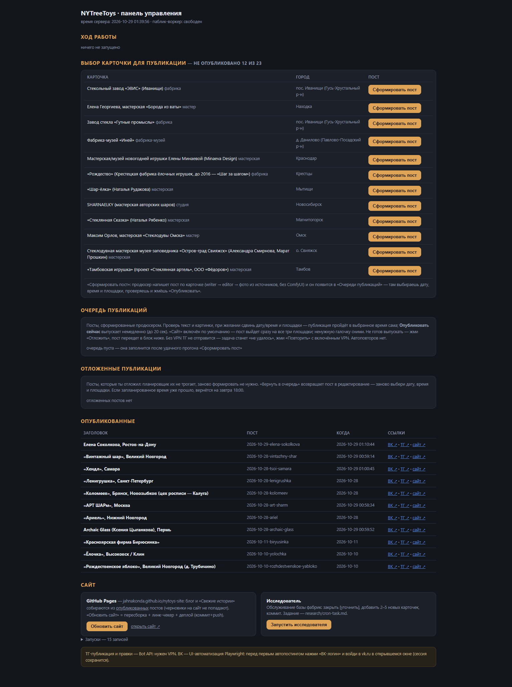
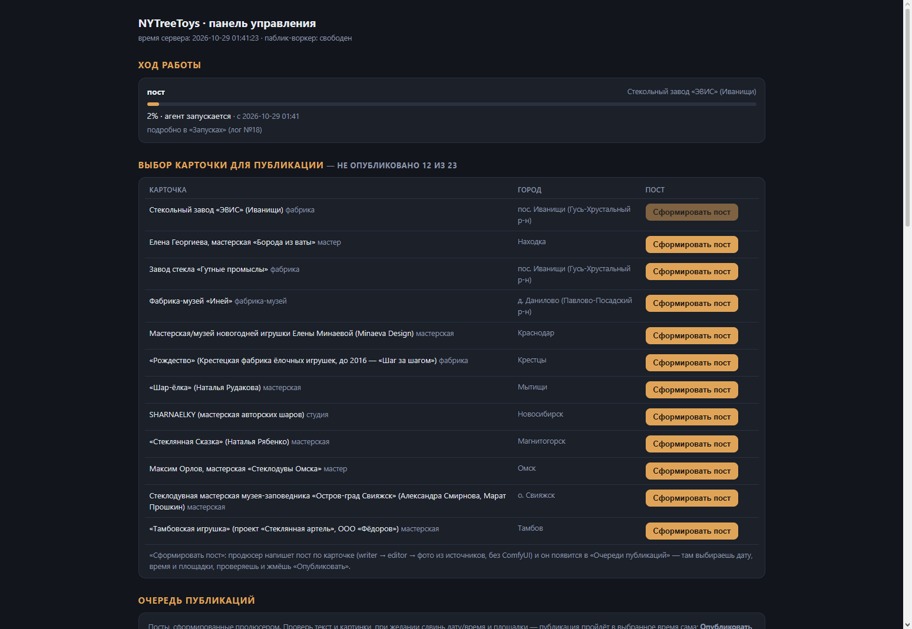
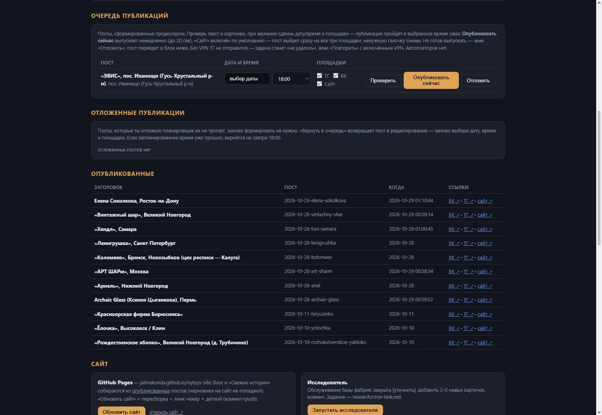
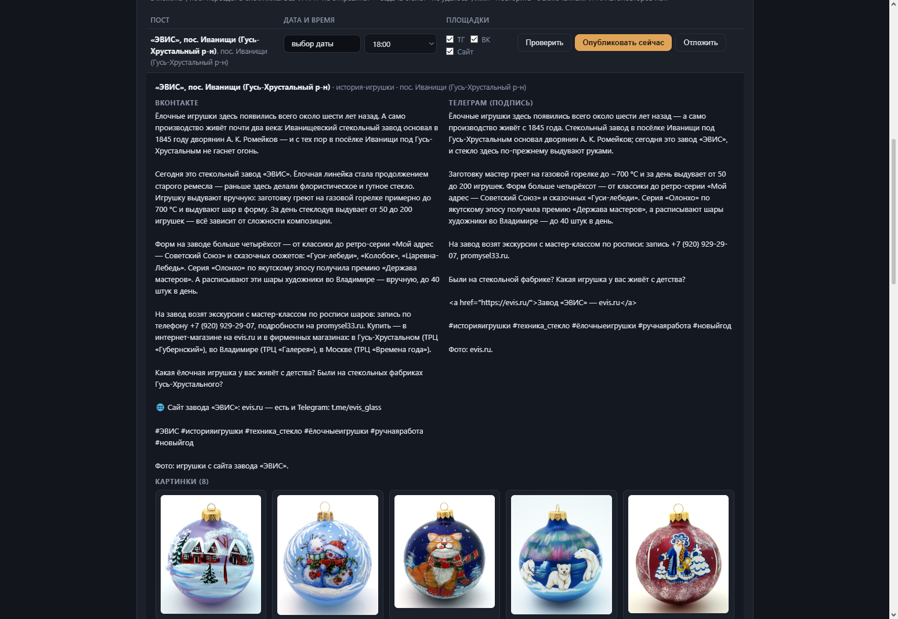
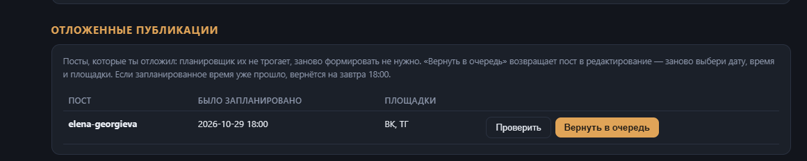
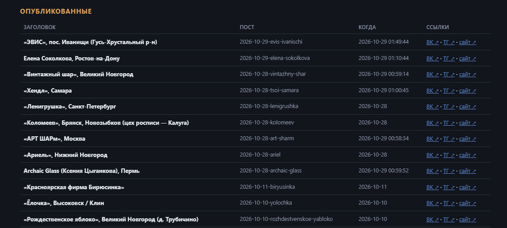
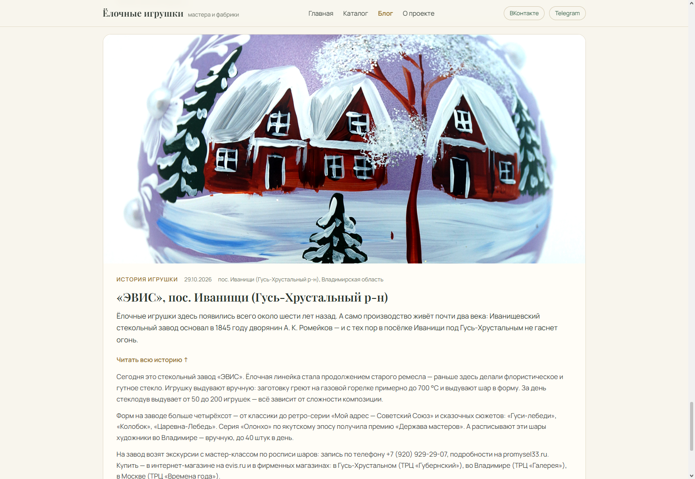
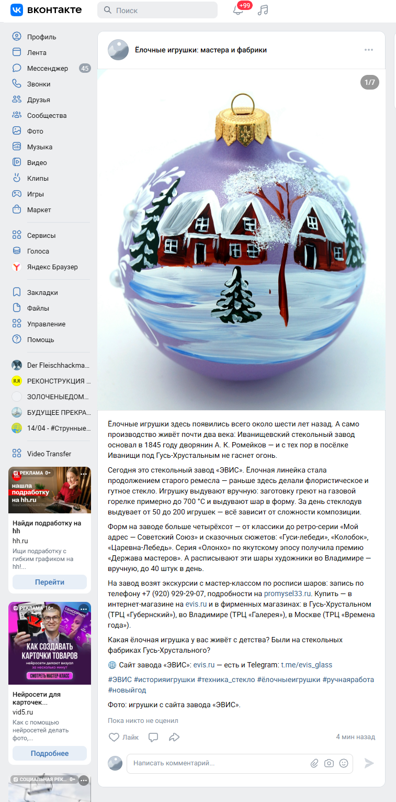
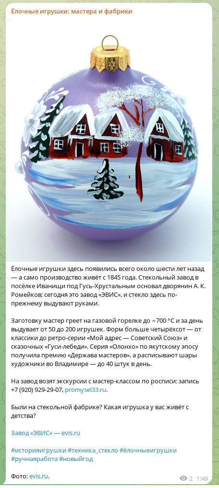

# Ёлочные игрушки — мастера и фабрики 🎄

Локальная панель-автопилот на ИИ-агентах: собирает базу фабрик ёлочных игрушек, готовит и проверяет посты, публикует их в соцсети и на сайт-агрегатор — по одному клику.

[Сайт-агрегатор](https://jahnakonda.github.io/nytoys-site/index.html) · [ВК-группа](https://vk.ru/nytreetoys) · [ТГ-канал](https://t.me/nytreetoys)


---

## Проблема

Общего каталога мастеров и фабрик ёлочных игрушек не существует — информация разрозненна по сайтам, соцсетям и статьям, а живых публикаций об отрасли почти нет. Проект собирает такие материалы сам: находит фабрики, пишет о них посты и регулярно ведёт два паблика и сайт-агрегатор.

## Пользователь

- Аудитория, интересующаяся ёлочной игрушкой ручной работы: коллекционеры, покупатели, мастера-смежники.
- Владелец проекта — как редактор: управляет пайплайном через локальную веб-панель, просматривает и подтверждает каждый пост перед публикацией.

## Основная функция

Локальная бэкенд-панель, которая при помощи агентов Claude Code делает всю редакционную работу:

1. **Исследователь** собирает информацию о фабриках и мастера в интернете и формирует базу карточек (`research/fabriki/*.json`) со ссылками на интернет-ресурсы — источник фактологии для постов.
2. **Продюсер** по карточке готовит пост: пишет текст → редактура → фото из источников (сайт фабрики — достаточный источник, без ИИ-генерации по умолчанию), собирает `posts/*.json` и ставит пост в очередь.
3. **Панель** показывает очередь: владелец выбирает дату, время и площадки (ВК / ТГ / сайт), просматривает пост («Проверить»), после этого публикация идёт сама — по расписанию или «Опубликовать сейчас».
4. **Публикаторы** выкладывают пост в [ВК-группу](https://vk.ru/nytreetoys) (UI-автоматизация браузера Edge) и [ТГ-канал](https://t.me/nytreetoys) (Bot API), а сайт-агрегатор пересобирается и деплоится на GitHub Pages автоматически.

```
Карточка → «Сделать пост» → producer [writer → editor → fetch-photos] → очередь (draft)
    → владелец: дата/время/площадки → планировщик → ВК + ТГ + сайт
```

### Агенты (`.claude/agents/`)

| Агент | Чем занимается |
|---|---|
| `nytoys-producer` | Диспетчер пайплайна: запускает writer → editor → фото, сводит отчёт. Публикацию не делает — ждёт подтверждения владельца |
| `nytoys-writer` | Пишет текст поста по правилам скилла NYTreeToys-content: рубрика, фактология строго из карточки, image_prompt |
| `nytoys-editor` | Проверяет готовый пост на орфографию и стиль, правит, отчитывается списком изменений |
| `nytoys-fetch-photos` | Скачивает фото с сайта/паблика фабрики, отбирает и раскладывает в `assets/` |
| `nytoys-image` | Генерирует картинку в ComfyUI (Z-Image Turbo / KREA 2) — запасной путь, когда фото взять неоткуда |
| `nytoys-researcher` | Ищет фабрики и мастеров по вебу и соцсетям, ведёт базу карточек и индекс `research/INDEX.md` |
| `nytoys-pub-tg` | Ручная публикация в ТГ (Bot API, требует VPN) |
| `nytoys-pub-vk` | Ручная публикация в ВК (UI-автоматизация Edge) |

## Формат результата

- **Сайт-агрегатор** с каталогом фабрик и блогом опубликованных постов: [jahnakonda.github.io/nytoys-site](https://jahnakonda.github.io/nytoys-site/index.html)
- **Регулярные посты** в [ВК-группе](https://vk.ru/nytreetoys) и [ТГ-канале](https://t.me/nytreetoys) — с живыми фото фабрик и ссылками на источники
- **База карточек фабрик** (24 карточки) — открытый JSON в `research/fabriki/`

## Минимальный функционал (MVP)

✅ Реализовано в первой версии:
- статический сайт-агрегатор на GitHub Pages с блогом только из опубликованных постов
- локальная веб-панель: запуск агентов, живой прогресс, очередь публикаций с расписанием, отложенные, «Опубликованные» со ссылками
- автопостинг в две соцсети (ВК, ТГ) с проверкой перед публикацией и без дублей при повторе
- параллельные запуски агентов с сериализацией git-коммитов

🔮 В планах:
- сайт на собственном хостинге
- автопостинг в другие соцсети
- генерация тематических имиджей ИИ-моделями в ComfyUI
- редактирование постов в панели перед публикацией
- сделать дизайн группы ВК

## Технологии

- **Python 3.13** — бэкенд и публикаторы; только стандартная библиотека, без фреймворков
- **SQLite** (`sqlite3`) — состояние панели: запуски, очередь, опубликованные
- **http.server.ThreadingHTTPServer** — локальный HTTP-сервер `127.0.0.1:8123` (API + статика)
- **threading** — фоновые агенты, планировщик публикаций (опрос 20 с), глобальный замок публикации
- **subprocess** — headless Claude Code (`claude -p --output-format stream-json`); файловый замок `panel/commit_safe.py` (`msvcrt.locking`) сериализует коммиты параллельных агентов
- **requests** — ТГ Bot API (`sendMediaGroup`/`sendPhoto`); токен читается из `secrets/` (вне git)
- **Playwright** (sync) — публикация в ВК через UI: Edge (`launch_persistent_context`, профиль с куки сессии), селекторы `data-testid`, перехват file chooser, скриншоты падений
- **Vanilla JS / HTML / CSS** — фронтенд панели (один файл, сборки нет) и сайт; шрифты Manrope + Playfair Display (woff2)

Форматы данных:

| Формат | Содержимое |
|---|---|
| JSON | посты `posts/*.json` (title, city, photos[], тексты площадок, ссылки публикации), карточки фабрик `research/fabriki/*.json`, API-ответы |
| SQLite | состояние панели (`panel/panel.db`) |
| stream-json | поток событий агентов для живого прогресса |
| Markdown | задания агентам, скилл NYTreeToys-content |
| JPG/PNG | фото постов (`assets/`, вне git), скриншоты падений ВК |

## Быстрый старт

```bash
pip install requests playwright
python -m playwright install msedge   # или использовать системный Edge

cd work/own/zavod_NYTreeToys
python panel/server.py
# → http://127.0.0.1:8123
```

Перед первым автопостингом в ВК один раз нажать «ВК-логин» в панели и войти в vk.ru в открывшемся окне. Токен ТГ-бота и доступы — в `secrets/` (в git не входит).

## Структура репозитория

```
├── panel/                  # панель-автопилот
│   ├── server.py           # HTTP + SQLite + планировщик публикаций
│   ├── publish_tg.py       # публикатор ТГ (Bot API)
│   ├── publish_vk.py       # публикатор ВК (Playwright + Edge)
│   ├── commit_safe.py      # сериализация git-коммитов параллельных агентов
│   ├── producer-task.md    # задание headless-продюсеру
│   └── static/index.html   # интерфейс панели
├── posts/                  # готовые посты (JSON)
├── research/               # база фабрик (карточки + индекс + задания исследователю)
├── site/                   # сайт-агрегатор (деплой на GitHub Pages)
├── assets/                 # фото постов (не коммитится)
└── .claude/                # субагенты, скилл NYTreeToys-content
```

## Границы и безопасность

- Сервер слушает только localhost, наружу не смотрит; автопостинг создаётся только вручную через панель.
- Секреты (токены ТГ, куки сессий ВК в `panel/vk-profile/`, `panel.db`) — вне git, не выгружаются.
- Публикация наружу — только после явного подтверждения владельца («Опубликовать» / «Повторить» в панели).

## Скриншоты
Нажимаем кнопку "сформировать пост"


Сформированный пост попадает в блок "очередь публикаций", где можно выбрать дату и время поста и площадки для публикации, а так же проверить его, опубликовать или отложить .




После публикации пост попадает в опубликованные, где есть ссылки на все площадки где он опубликован. В принципе результаты можно посмотреть по ссылкам выше.




